# 🚀 Awesome Blogging Platform

  

  
  
  
  
  
  

---

## 🌟 Top Blogging Platform Ecosystem

**Curated Directory of Cloud SaaS/Hosted Publishing Engines & Open-Source GitHub Projects**  
*Comprehensive developer and writer guide covering Minimalist Markdown Blogs, Self-Hosted CMS Engines, Static Site Generators (SSG), Email Newsletters, and Federated ActivityPub/Fediverse Networks.*

**Last updated:** November 2026

Welcome to the definitive, SEO-optimized awesome list tracking cutting-edge **SaaS publishing services** and **open-source repositories** across the digital publishing landscape. Whether you are crafting technical developer documentation, running an indie newsletter, scaling an enterprise publication, or deploying a privacy-respecting personal journal, this directory maps the finest solutions available today.

---

## 📑 Table of Contents

- [📊 Sector Overview & Market Dynamics](#-sector-overview--market-dynamics)
- [☁️ SaaS & Hosted Platforms](#️-saas--hosted-platforms)
- [💻 Open-Source GitHub Projects](#-open-source-github-projects)
  - [🏆 Ranked by GitHub Stars](#-ranked-by-github-stars)
  - [🛠️ Complementary Open-Source Tools](#️-complementary-open-source-tools)
- [🤝 How to Contribute](#-how-to-contribute)
- [💖 Support & Share](#-support--share)
- [📈 Star History](#-star-history)
- [⚖️ Disclaimer](#️-disclaimer)

---

## 📊 Sector Overview & Market Dynamics

The global blogging and web publishing platform sector is valued at approximately **$5.2 billion** (within the broader $34B+ content management system market), expanding steadily at a **10–14% CAGR**.

The market dynamics exhibit **moderate fragmentation** rather than a winner-take-all monopoly:
- **De-monopolization of Traditional CMS:** While legacy giants (notably WordPress via Automattic) command massive foundational CMS usage, creators and engineers increasingly migrate toward specialized modular architectures.
- **Rise of Paid Newsletters & Creator Networks:** Standalone newsletter ecosystems (Substack, beehiiv) have unlocked direct-to-audience creator economies without complex infrastructure setup.
- **Developer-Centric & Developer-Owned Writing:** Modern engineering blogs have standardized on high-velocity Static Site Generators (Astro, Hugo, Zola) paired with headless CMSs or Git-backed repositories (Hashnode, DEV.to/Forem).
- **Fediverse & Privacy-First Minimalist Nodes:** With increased concerns over proprietary data lock-in and ad surveillance, lightweight minimalist engines (Bear Blog, Mataroa) and ActivityPub federated protocols (Ghost, WriteFreely, Plume) provide independent data ownership.

---

## ☁️ SaaS & Hosted Platforms

A complete comparison of hosted blogging and publishing platforms, detailing exact entry-tier pricing, hard limits on free tiers/trials, and parent company financial scale (sorted descending by company valuation/revenue):

| Platform | Description | Pricing (Starting Paid Tier) | Free Tier Limits / Free Trial | Company Scale (Valuation / Revenue) |
| :--- | :--- | :--- | :--- | :--- |
| **[Blogger (Google)](https://blogger.com)** | Long-running hosted blogging platform by Google offering custom domains, built-in themes, and AdSense integration. | $0 (Free hosted service; custom domain registration purchased separately ~$12/yr) | Free forever: 100 blogs per account, up to 1GB Google Photos storage for media, 20 static pages per blog, standard Google bandwidth limits. | Parent Alphabet: ~$3.3T Market Cap / $400B+ Annual Revenue |
| **[WordPress.com (Automattic)](https://wordpress.com)** | Managed cloud hosting platform built on WordPress offering automated backups, global CDN, and plugin ecosystems. | $4/month (Personal plan, billed annually at $48/yr; or $9/mo month-to-month) | Free forever: 1 GB storage, `*.wordpress.com` subdomain, unlimited pages/posts; no custom plugins/themes, displays WordPress ads. | Automattic: $7.5B Valuation / ~$500M+ Annual Revenue |
| **[Substack](https://substack.com)** | Creator-focused newsletter and long-form blogging platform combining web publishing, paid subscriptions, and built-in reader discovery. | 10% platform take-rate cut on paid subscription revenue (no recurring monthly platform subscription fee) | Free forever: Unlimited subscribers, unlimited posts/newsletters sent, unlimited web hosting; 10% cut applies only when charging readers; $50 one-time fee for custom domains. | Substack: $1.1B Valuation / ~$45M ARR |
| **[beehiiv](https://beehiiv.com)** | Modern newsletter and web-publishing platform engineered for audience growth, referral programs, and built-in monetization. | $49/month (Lite plan, billed annually at $588/yr; or $59/mo month-to-month) | Free forever (Free plan): Up to 2,500 active subscribers, unlimited email sends, custom domain support, basic analytics; 0 monetization tools on free tier. | beehiiv: ~$192M Valuation / ~$35M+ ARR |
| **[Medium](https://medium.com)** | Social publishing and digital reading platform connecting writers with a built-in audience and Partner Program monetization. | $5/month (or $50/year for Medium Member reader plan; publishing is free) | Free forever: Unlimited free story publishing (rate-limited to 2–3 stories per rolling 24 hours for anti-spam), limited member-only story reads per month. | Medium: ~$176M VC Funding Raised / ~$61M Annual Revenue |
| **[DEV.to](https://dev.to)** | Major developer community blogging platform (powered by Forem) for sharing tutorials, technical articles, and open-source updates. | $0 for creators (Community publishing is free; enterprise Forem hosting / sponsorships are custom-quoted) | Free forever: Unlimited posts, unlimited community reading, unlimited comments, custom canonical URLs, profile/organization pages. | DEV / Forem: $11.5M VC Funding Raised / Undisclosed ARR |
| **[Ghost(Pro)](https://ghost.org)** | Official managed hosting service for the open-source Ghost CMS, providing turnkey memberships, paid newsletters, and custom themes. | $15/month (Starter plan, billed annually at $180/yr; or $18/mo month-to-month) | 14-day free trial (full Starter plan capabilities up to 1,000 members, 1 staff user, no billing during trial); no permanent free hosting tier. | Ghost Foundation: Bootstrapped Non-Profit ($0 Valuation) / ~$11.1M ARR |
| **[Hashnode](https://hashnode.com)** | Developer-centric blogging platform offering custom domain mapping, GitHub backup sync, and an active engineering community. | $5/month per seat/publication (Pro plan, billed annually at $50/yr) | Free forever: 1 publication/blog on `*.hashnode.dev` subdomain, unlimited articles, markdown editor, comments, basic analytics. | Hashnode: $10M VC Funding Raised / Undisclosed ARR |
| **[Write.as](https://write.as)** | Distraction-free, privacy-respecting minimalist publishing and Fediverse-connected blogging service powered by WriteFreely. | $6/month (Pro plan, billed annually at $72/yr; or $9/mo month-to-month) | Free forever: 1 personal blog on Write.as subdomain, 3 to 15 posts per day, plain-text editor, RSS & ActivityPub federation (no custom domain/CSS). | Musing Studio: Bootstrapped / ~$150K Annual Revenue |
| **[Bear Blog](https://bearblog.dev)** | Privacy-first, ultra-minimalist Markdown blogging platform with zero JavaScript bloat, no trackers, and built-in RSS. | $5/month (or $49/year; or $189 one-time lifetime license) | Free forever: 1 blog on `*.bearblog.dev` subdomain, unlimited markdown posts, built-in RSS/Atom feeds; no custom domain, no image upload storage. | Bootstrapped Solo Indie / ~$60K ARR |

---

## 💻 Open-Source GitHub Projects

Explore the finest self-hosted CMS applications, static site engines, and decentralized blogging networks.

### 🏆 Ranked by GitHub Stars

*Repositories are sorted in descending order of current GitHub stargazer counts.*

1. **[Hugo](https://github.com/gohugoio/hugo)**   
   The world’s fastest open-source static site generator and framework written in Go. Compiles thousands of Markdown blog posts into production HTML/CSS in milliseconds with zero dependencies and built-in asset bundling.

2. **[Astro](https://github.com/withastro/astro)**   
   The modern web framework for content-driven websites, blogs, and documentation. Delivers zero-JS-by-default performance, Content Collections with strict TypeScript schema validation, Markdown/MDX authoring, and islands architecture.

3. **[Ghost](https://github.com/TryGhost/Ghost)**   
   Leading open-source Node.js publishing platform for independent writers, publishers, and publications. Features a rich lexical block editor, native email newsletter distribution, paid subscription memberships, and ActivityPub federation.

4. **[Jekyll](https://github.com/jekyll/jekyll)**   
   The battle-tested Ruby static site generator natively integrated with GitHub Pages. Transforms raw Markdown, Liquid templates, and directory hierarchies into deployable, zero-maintenance static websites.

5. **[Hexo](https://github.com/hexojs/hexo)**   
   A lightning-fast, simple, and powerful blogging framework powered by Node.js. Supports one-command multi-platform deployment, super-fast post generation, and an extensive plugin and theme ecosystem.

6. **[Listmonk](https://github.com/knadh/listmonk)**   
   High-performance self-hosted newsletter and mailing list manager packaged as a single Go binary with PostgreSQL. Features public web archive modes ideal for independent Substack-style newsletter blogs and multi-list publishing.

7. **[Forem](https://github.com/forem/forem)**   
   Open-source community blogging and discussion software engineered in Ruby on Rails, powering the DEV.to developer network. Designed for building collaborative blogging and creator communities.

8. **[WordPress](https://github.com/WordPress/WordPress)**   
   The world's most widely deployed open-source content management and blogging software (PHP/MySQL). Features the Gutenberg block editor, REST API, multi-author workflows, and thousands of themes and plugins.

9. **[Eleventy (11ty)](https://github.com/11ty/eleventy)**   
   Simpler, flexible JavaScript static site generator that transforms template directories (Markdown, Nunjucks, Liquid, WebC) into production HTML with zero client-side JavaScript lock-in.

10. **[Zola](https://github.com/getzola/zola)**   
    Blazing-fast static site generator written in Rust, distributed as a single zero-dependency binary. Features built-in Sass compilation, syntax highlighting, search indexing, and Tera templating.

11. **[Grav](https://github.com/getgrav/grav)**   
    Modern, fast, flat-file CMS built on PHP, Markdown, Twig, and Symfony. Eliminates traditional SQL database overhead while delivering an extensible plugin architecture and powerful admin dashboard.

12. **[Pelican](https://github.com/getpelican/pelican)**   
    Popular static site generator for Python developers supporting Markdown and reStructuredText (reST) syntax. Easily integrates Jinja2 templates and feeds (RSS/Atom).

13. **[Publii](https://github.com/GetPublii/Publii)**   
    Intuitive desktop-based Static Site CMS designed for building fast, SEO-optimized, privacy-focused static blogs without terminal commands. Directly syncs output to GitHub Pages, GitLab, Netlify, or AWS S3.

14. **[SilverBullet](https://github.com/silverbulletmd/silverbullet)**   
    An extensible, open-source personal knowledge base and publishing notebook powered by Markdown and Lua. Runs locally or in the cloud with live sync and clean web-reading views.

15. **[WriteFreely](https://github.com/writefreely/writefreely)**   
    Clean, minimalist open-source Go blogging platform supporting distraction-free Markdown publishing, multi-user community publications, and native ActivityPub federation across the Fediverse.

16. **[Bear Blog Core](https://github.com/HermanMartinus/bearblog)**   
    The open-source Django codebase powering Bear Blog. Engineered for ultra-lightweight, zero-bloat Markdown blogging with tiny CSS stylesheets and instant load times.

17. **[Plume](https://github.com/Plume-org/Plume)**   
    Federated blogging engine implemented in Rust, built natively on top of the ActivityPub protocol to share articles seamlessly with Mastodon and the broader Fediverse.

18. **[Bludit](https://github.com/bludit/bludit)**   
    Simple, fast, secure flat-file CMS using JSON files to store content. Ideal for lightweight blogs and documentation sites requiring quick setup with zero SQL database configuration.

19. **[Mataroa](https://github.com/mataroa-blog/mataroa)**   
    A naked, minimalist blogging platform core designed around pure HTML/Markdown, privacy protection, automatic RSS feeds, and zero JavaScript bloat.

---

### 🛠️ Complementary Open-Source Tools

Supercharge your static or self-hosted blogging stack with these essential open-source integrations:

- **[Giscus](https://github.com/giscus/giscus)**  — Comment system powered by GitHub Discussions for static sites.
- **[Remark42](https://github.com/umputun/remark42)**  — Privacy-focused, lightweight, self-hosted commenting engine.
- **[Linkding](https://github.com/sissbruecker/linkding)**  — Self-hosted, minimalist bookmark manager for curated link-blogging.

---

## 🤝 How to Contribute

Contributions are welcome and highly appreciated! To submit a new blogging platform, CMS, or static site generator:

1. 🍴 **Fork the repository** on GitHub.
2. 🌿 **Create a new branch** (`git checkout -b feature/add-new-platform`).
3. 📝 **Add or update the platform entry** following the established format:
   - Include platform name, live/repo URL, 1–2 sentence factual summary, starting pricing, and free tier limits.
   - For open-source repos, ensure you add the star badge linked to the repo's stargazers page.
4. 🚀 **Commit your changes** (`git commit -m "Add NewPlatform to open-source list"`).
5. 📬 **Open a Pull Request** describing your additions.

⭐ If you find this directory valuable, please star this repository to help others discover it!

---

## 💖 Support & Share

Thank you for exploring and using **Awesome Blogging Platform**! Creating and maintaining this curated directory takes continuous research and testing. If this repository has helped you discover your next publishing tool or build a better blogging stack, please consider supporting the project:

- ⭐ **Star this repository** on GitHub to help boost its visibility.
- 🍴 **Fork and share** the project with your developer network, colleagues, and blogging community on X/Twitter, LinkedIn, and Reddit.
- ☕ **Buy me a coffee & sponsor my open-source work**: Support future updates, directory maintenance, and new open-source initiatives via the [GitHub Sponsors Dashboard](https://github.com/sponsors/ishandutta2007).

  

---

## 📈 Star History

---

## ⚖️ Disclaimer

- This repository is a **community-curated, educational directory** — listings do not constitute an endorsement.
- All product names, logos, and brands are property of their respective owners.
- **Data Ownership Best Practice:** Always maintain independent Markdown/XML backups and DNS control over your custom domains to ensure seamless content portability across platforms.

---

  <b>Crafted with ❤️ for writers, indie creators, developers, and open-source advocates worldwide.</b>

